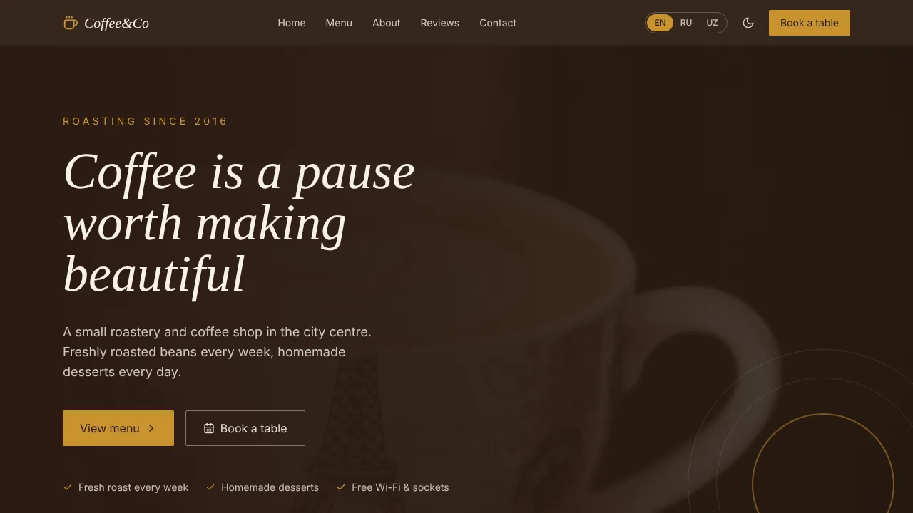
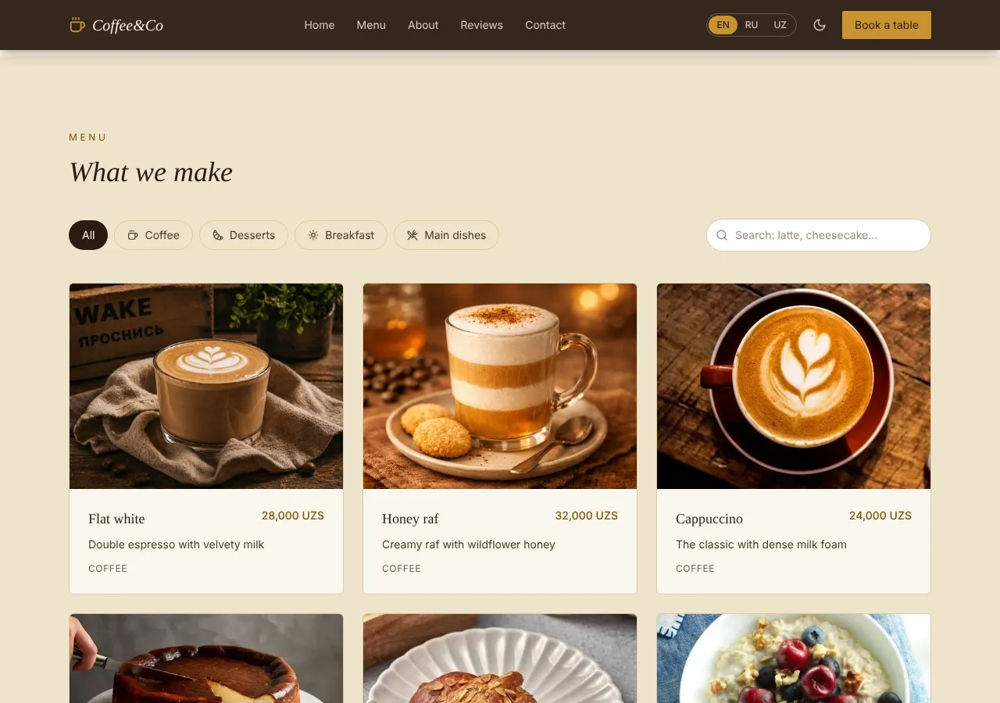
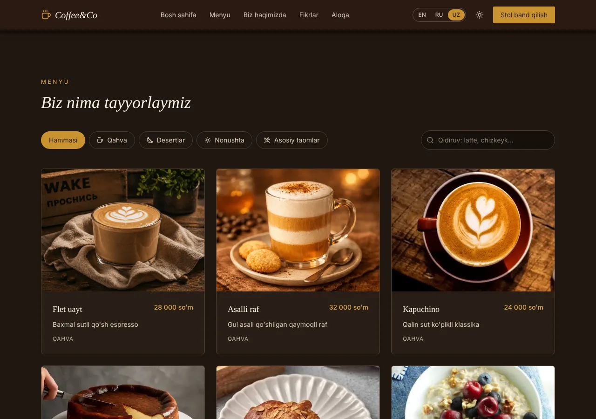
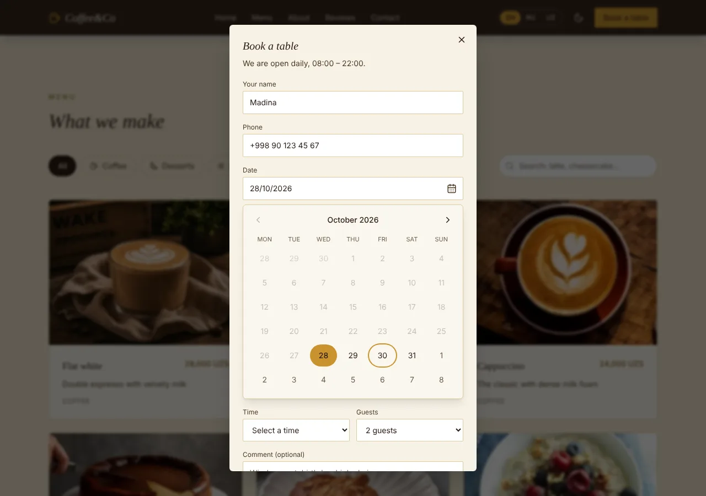
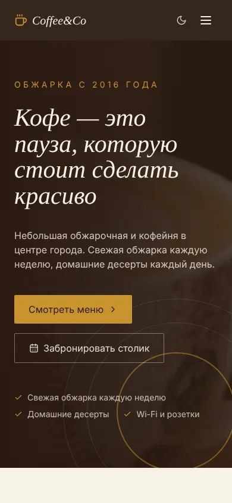
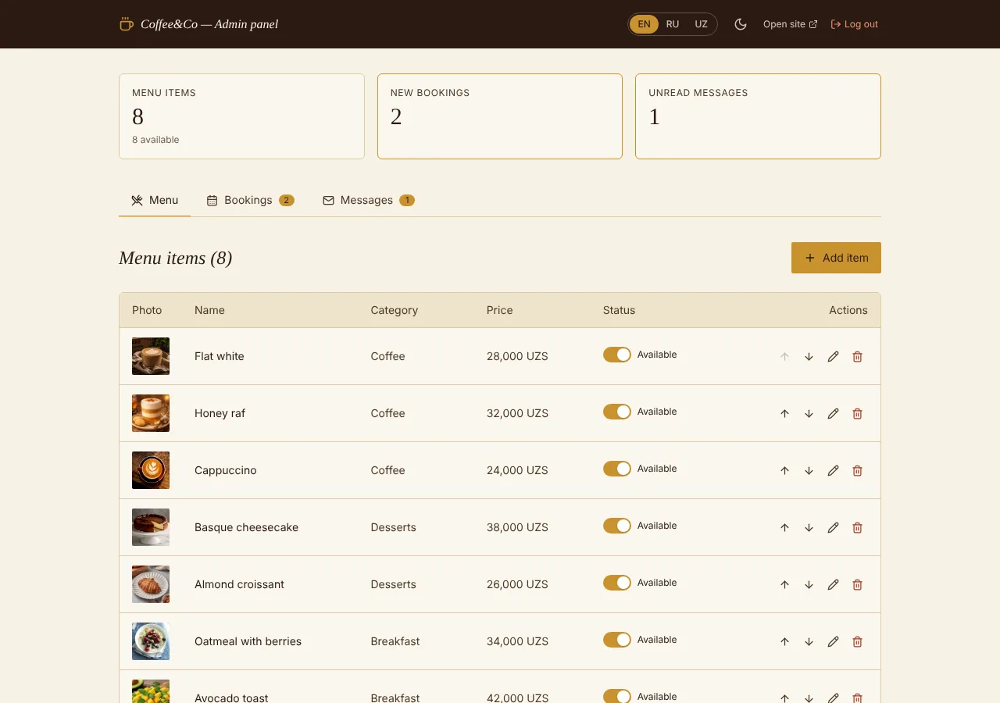
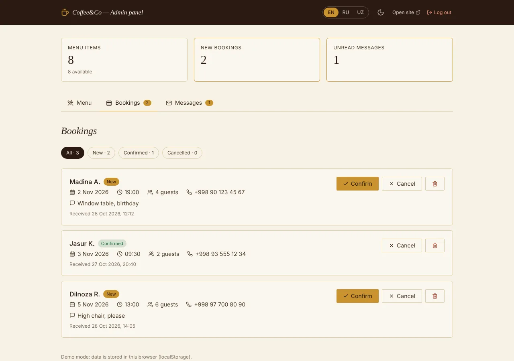

# Coffee&Co — coffee shop website with online booking & admin panel

A production-ready website for a coffee shop or restaurant. Guests browse the menu, book a table and send messages
in **English, Russian or Uzbek**; the owner manages the menu, bookings and messages in a simple admin panel.

**Live demo:** [sheralikuziyev4007-cafe-booking-web-one.vercel.app](https://sheralikuziyev4007-cafe-booking-web-one.vercel.app/) · **Admin:** [/admin](https://sheralikuziyev4007-cafe-booking-web-one.vercel.app/admin) (`admin` / `admin123`)




## Why this project

| Business need | Solution |
| --- | --- |
| The owner changes the menu without a developer | Admin panel: add / edit / delete items, photos, prices, stop-list, ordering |
| Tourists and locals speak different languages | Full EN / RU / UZ interface; menu items are translated per language with automatic fallback |
| Fewer phone calls, more bookings | "Book a table" form with date, time slots within opening hours and number of guests |
| Never miss a request | Every booking and message lands in the admin panel with a "new" badge and counters |
| Found on Google, looks great when shared | Open Graph preview, `CafeOrCoffeeShop` structured data, sitemap, Lighthouse SEO 100 |
| Fast on any phone | ~88 KB gzipped JS for the landing page, admin code is lazy-loaded, responsive images (`srcset`), Lighthouse Performance 97–98 mobile / 100 desktop |

## Features

**Website**

- Hero, about, menu, reviews, contact, footer — responsive from 375 px to wide desktops
- Menu with category tabs, **search across all languages** and a detail view for every item
- Items on the stop-list stay visible with a "Not available today" badge
- **Online table booking**: date typed as **dd/mm/yyyy** or picked in an accessible calendar (today … +60 days), 30-minute time slots within opening hours, 1–12 guests
- **Phone mask** `+998 90 123 45 67`: letters are ignored, the caret stays in place while editing, incomplete numbers are rejected; other countries in `+<country code>` format
- Contact form with validation and a success message
- Language switcher (remembers the choice, detects the browser language) and **light / dark theme** without a flash on load
- Scroll-reveal animations that respect `prefers-reduced-motion`

**Admin panel (`/admin`)**

- Sign-in, protected routes, sign-out
- Dashboard counters: menu items, new bookings, unread messages
- Menu: create / edit / delete with confirmation, translations in three tabs, image preview, availability switch, reorder
- Bookings: filter by status, confirm / cancel / delete, click-to-call
- Messages: unread highlighting, mark as read, reply via `mailto:` / `tel:` link
- The whole panel is translated too

**Quality**

- TypeScript strict, no `any`; small single-purpose components
- Accessibility: labelled fields, `role="dialog"` with focus trap and focus return, `aria-pressed`, `role="switch"`, contrast ≥ 4.5:1 in both themes
- 89 automated tests (Vitest + Testing Library): validators, phone and date masks, storage migration, formatting, and full user flows (booking, calendar, contact form, admin CRUD)
- GitHub Actions CI: lint → typecheck → tests → build
- `npm audit`: 0 vulnerabilities

### Lighthouse

Measured with Lighthouse 12 on the production build (`npm run build && npm run preview`), median of 3 runs:

| | Performance | Accessibility | Best Practices | SEO |
| --- | --- | --- | --- | --- |
| Desktop | 100 | 100 | 100 | 100 |
| Mobile | 98 | 100 | 100 | 100 |

## Screenshots

| Menu with categories and search | Dark theme, Uzbek |
| --- | --- |
|  |  |

| Table booking | Mobile, Russian |
| --- | --- |
|  |  |

| Admin: menu | Admin: bookings |
| --- | --- |
|  |  |

## Tech stack

- React 18 + TypeScript, React Router 7 (lazy-loaded admin routes)
- Vite 6, Tailwind CSS 3 (theme tokens via CSS variables), lucide-react icons
- Context API for state: i18n, theme, auth, menu, inbox
- Vitest, Testing Library, jsdom; ESLint; GitHub Actions

## Project structure

```
src/
├── config/site.ts         # ⭐ business details: name, address, phone, hours, booking rules, social links
├── data/seedData.ts       # initial menu and reviews (in 3 languages)
├── i18n/                  # en.ts (source of truth for keys), ru.ts, uz.ts — type-checked to match
├── components/
│   ├── landing/           # Header, Hero, About, MenuSection, MenuCard, MenuItemModal, BookingModal, Reviews, Contact, Footer
│   ├── admin/             # AdminLayout, AdminMenuPage, AdminBookingsPage, AdminMessagesPage, ItemFormModal, …
│   └── ui/                # Button, Input, Select, Modal, Reveal, LanguageSwitcher, ThemeToggle, …
├── context/               # providers: I18n, Theme, Auth, Menu, Inbox
├── hooks/                 # useI18n, useTheme, useAuth, useMenu, useInbox, useLocalStorage
├── utils/                 # validators, formatters, storage parsers (with migration of old data)
└── test/                  # integration tests and helpers
```

## Getting started

Requires Node.js 22.22+ (Vitest 5 and jsdom 30 need it).

```bash
npm install
npm run dev          # http://localhost:5173
```

```bash
npm run check        # everything before a commit: lint → typecheck → tests → build
npm test             # run tests once (npm run test:watch — watch mode)
npm run lint
npm run typecheck
npm run build        # typecheck + production build
npm run preview      # serve the production build
```

## Using it for another business

1. Edit `src/config/site.ts` — name, address, phone, hours, booking rules, map, social links.
2. Replace the menu and reviews in `src/data/seedData.ts` and the photos in `public/images/`.
3. Update texts in `src/i18n/*.ts`; TypeScript reports any key missing in a language.
4. Update the domain in `index.html` (canonical, Open Graph, JSON-LD), `public/robots.txt` and `public/sitemap.xml`.

## Deployment

- **Vercel** (recommended): import the repository — Vite is detected automatically. `vercel.json` adds the SPA fallback,
  long-term caching for hashed assets and security headers.
- **Netlify**: build `npm run build`, publish `dist` (`public/_redirects` provides the SPA fallback).

## Production notes

Admin authentication and data storage are intentionally lightweight for the demo: the credentials are in client code
and data lives in `localStorage`, so it is per-browser. For a real business, connect a backend (e.g. Supabase or
Firebase: auth + database + image storage). Data access is isolated in the providers in `src/context/`, so the UI
does not need to change.

## License

[MIT](./LICENSE)
