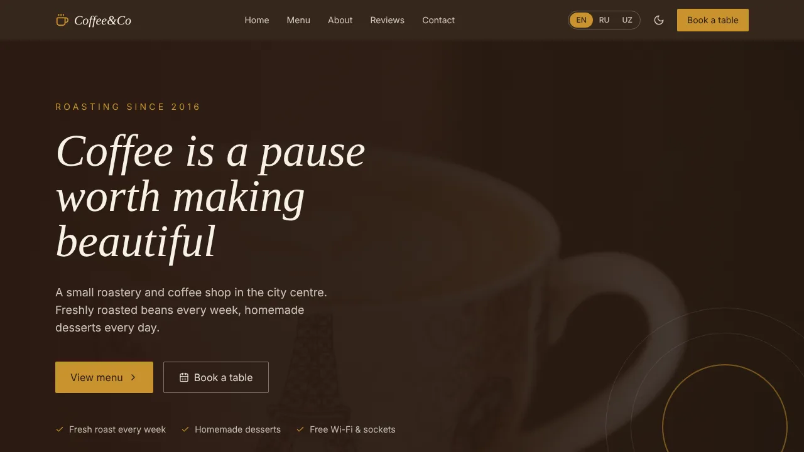
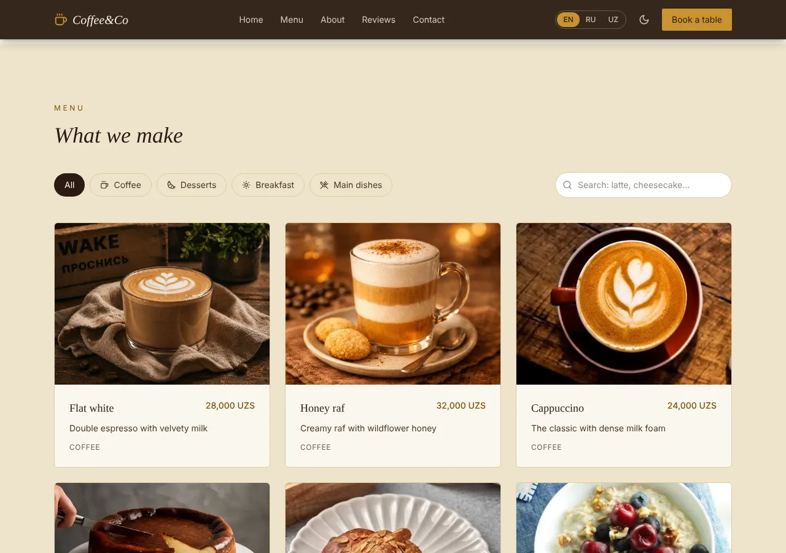
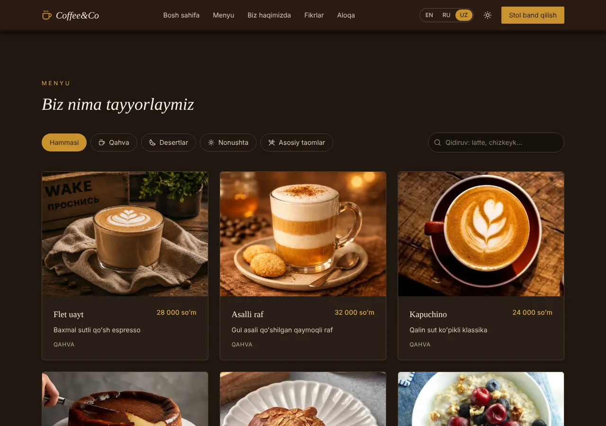
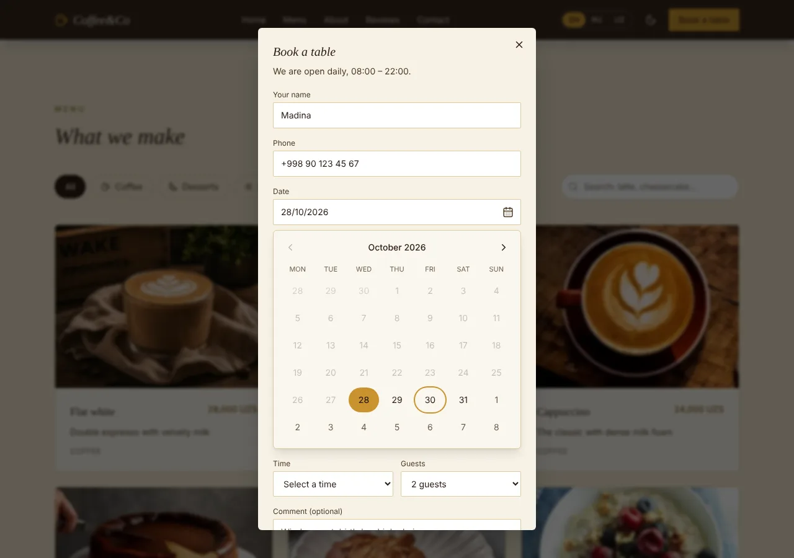
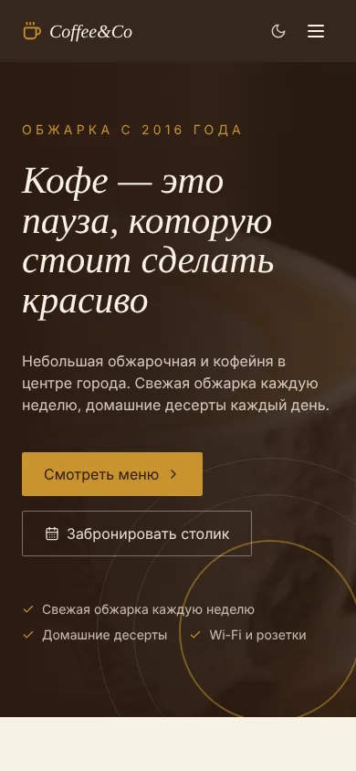
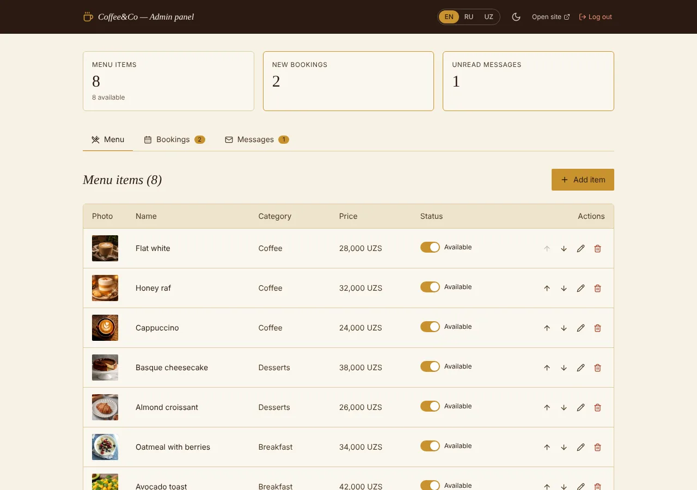
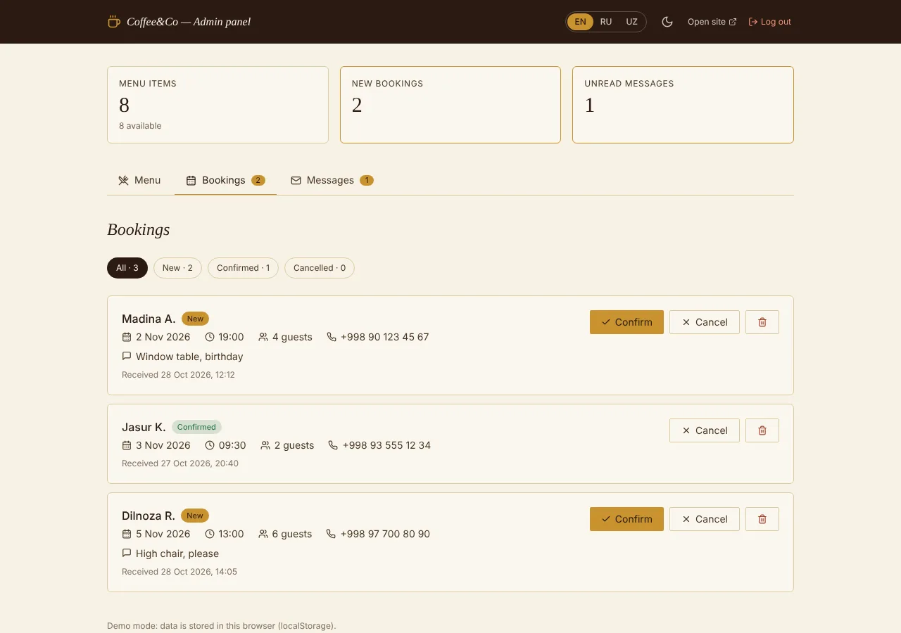

# Coffee&Co — coffee shop website with online booking & admin panel

A production-ready website for a coffee shop or restaurant. Guests browse the menu, book a table and send messages
in **English, Russian or Uzbek**; the owner manages the menu, bookings and messages in a simple admin panel.

**Live demo:** [cafe-booking-web.vercel.app](https://cafe-booking-web.vercel.app/) · **Admin:** [/admin](https://cafe-booking-web.vercel.app/admin) (`admin` / `admin123` — public demo credentials, see [Demo mode](#demo-mode-and-credentials))





## Why this project

| Business need | Solution |
| --- | --- |
| The owner changes the menu without a developer | Admin panel: add / edit / delete items, photos, prices, stop-list, ordering |
| Tourists and locals speak different languages | Full EN / RU / UZ interface; menu items are translated per language with automatic fallback |
| Fewer phone calls, more bookings | "Book a table" form with date, time slots within opening hours and number of guests |
| Never miss a request | Every booking and message lands in the admin panel with a "new" badge and counters, and (with the backend) a **Telegram message** to the owner's phone |
| No double bookings | Each time slot has a limit (6 tables by default). Full times are greyed out in the form and the database refuses the extra request, even if two guests click at the same moment |
| The owner sees requests from any device | Optional **Supabase** backend (Postgres, Auth, Row Level Security): a booking made on a guest's phone appears in the owner's panel. Without keys the site runs as a self-contained demo |
| Found on Google, looks great when shared | Open Graph preview, `CafeOrCoffeeShop` structured data, sitemap, Lighthouse SEO 100 |
| Fast on any phone | ~143 KB gzipped JS for the landing page (the validation library is downloaded only when a form is first submitted), admin code is lazy-loaded (and the Supabase SDK is a separate chunk that is downloaded only when a backend is configured), responsive images (`srcset`), Lighthouse Performance 96 mobile / 100 desktop |

## Features

**Website**

- Hero, about, menu, reviews, contact, footer — responsive from 375 px to wide desktops
- Menu with category tabs, **search across all languages** and a detail view for every item
- Items on the stop-list stay visible with a "Not available today" badge
- **Online table booking**: date typed as **dd/mm/yyyy** or picked in an accessible calendar (today … +60 days), 30-minute time slots within opening hours, 1–12 guests
- **Phone mask** `+998 90 123 45 67`: letters are ignored, the caret stays in place while editing, incomplete numbers are rejected; other countries in `+<country code>` format
- Contact form with validation and a success message
- Language switcher (remembers the choice, detects the browser language) and **light / dark theme** without a flash on load
- Scroll-reveal animations that respect `prefers-reduced-motion`

**Admin panel (`/admin`)**

- Sign-in, protected routes, sign-out. With a backend: real email + password accounts, and only accounts with the `admin` role get in
- Dashboard counters: menu items, new bookings, unread messages
- Menu: create / edit / delete with confirmation, translations in three tabs, image preview, availability switch, reorder
- Bookings: filter by status, confirm / cancel / delete, click-to-call
- Messages: unread highlighting, mark as read, reply via `mailto:` / `tel:` link
- The whole panel is translated too
- Changes appear instantly; if a request fails, the change is rolled back and a message explains what happened

**Quality**

- TypeScript strict, no `any`; small single-purpose components
- Accessibility: labelled fields, `role="dialog"` with focus trap and focus return, `aria-pressed`, `role="switch"`, contrast ≥ 4.5:1 in both themes
- Every request has **loading** (skeleton cards that match the real layout), **error** (message + retry button) and **empty** states; forms keep what the visitor typed when sending fails
- Forms use **React Hook Form + Zod**: one schema per form is the single source of truth for validation, and error messages are translated per language
- 180 unit and integration tests (Vitest + Testing Library): schemas, phone and date masks, storage migration, the Supabase data layer (against a fake client), the Telegram message builder, slot capacity, loading / error / empty states, rollback of failed changes, and full user flows (booking, calendar, contact form, admin CRUD)
- 22 end-to-end tests (Playwright, real Chrome): a guest books → the owner confirms, a full time cannot be chosen, menu management, no horizontal scroll at 360 / 768 / 1024 / 1440 px, axe accessibility scan in light and dark themes, keyboard-only booking
- The database schema, Row Level Security policies and the slot-capacity trigger were run on a real PostgreSQL engine (anonymous visitors, signed-in non-admins and admins) with 39 checks (`npm run test:db`)
- GitHub Actions CI: lint → typecheck → unit tests → database tests → build, plus a separate end-to-end job
- `npm audit`: 0 vulnerabilities

### Lighthouse

Measured with Lighthouse 12 on the production build (`npm run build && npm run preview`), median of 3 runs:

| | Performance | Accessibility | Best Practices | SEO |
| --- | --- | --- | --- | --- |
| Desktop | 100 | 100 | 100 | 100 |
| Mobile | 96 | 100 | 100 | 100 |

## Screenshots

| Menu with categories and search | Dark theme, Uzbek |
| --- | --- |
|  |  |

| Table booking | Mobile, Russian |
| --- | --- |
|  |  |

| Admin: menu | Admin: bookings |
| --- | --- |
|  |  |

## Tech stack

- React 19 + TypeScript, React Router 7 (lazy-loaded admin routes)
- Vite 6, Tailwind CSS 3 (theme tokens via CSS variables), lucide-react icons
- TanStack Query for server data (menu, bookings, messages), React Hook Form + Zod for forms, Context API for i18n, theme, auth
- Supabase (Postgres + Auth + Row Level Security) as an optional backend; without it the data lives in localStorage
- Vitest, Testing Library, jsdom, Playwright + axe-core; ESLint; GitHub Actions

## Project structure

```
src/
├── config/site.ts         # ⭐ business details: name, address, phone, hours, booking rules, social links
├── services/              # data layer: interfaces + two implementations
│   ├── local/             #   demo mode: localStorage menu / bookings / messages + demo login
│   └── supabase/          #   Supabase menu / bookings / messages / auth + row mapping
├── schemas/               # Zod schemas (contact, booking, menu item, login) + lazy resolver
├── lib/                   # TanStack Query client, lazily loaded Supabase client
├── data/seedData.ts       # initial menu and reviews (in 3 languages)
├── i18n/                  # en.ts (source of truth for keys), ru.ts, uz.ts — type-checked to match
├── components/
│   ├── landing/           # Header, Hero, About, MenuSection, MenuCard, MenuItemModal, BookingModal, Reviews, Contact, Footer
│   ├── admin/             # AdminLayout, AdminMenuPage, AdminBookingsPage, AdminMessagesPage, ItemFormModal, …
│   └── ui/                # Button, Input, Select, Modal, Reveal, LanguageSwitcher, ThemeToggle, …
├── context/               # providers: Services, I18n, Theme, Auth
├── hooks/                 # useMenu, useBookings, useMessages, useAuth, useI18n, useTheme, …
├── utils/                 # validators, formatters, storage parsers (with migration of old data)
└── test/                  # integration tests, fake backend and helpers
supabase/
├── schema.sql             # tables, Row Level Security policies, slot capacity, move_menu_item()
├── seed.sql               # starter menu (generated from src/data/seedData.ts)
└── functions/
    └── notify-telegram/   # Edge Function: Telegram message on a new booking / message
e2e/                       # Playwright end-to-end tests
```

## Getting started

Requires Node.js 22.22+ (Vitest 5 and jsdom 30 need it).

```bash
npm install
npm run dev          # http://localhost:5173
```

```bash
npm run check        # everything before a commit: lint → typecheck → tests → database policy tests → build
npm run e2e          # end-to-end tests in a real browser (first time: npx playwright install chromium)
npm test             # run tests once (npm run test:watch — watch mode)
npm run lint
npm run typecheck
npm run build        # typecheck + production build
npm run preview      # serve the production build
```

## Using it for another business

1. Edit `src/config/site.ts` — name, address, phone, hours, booking rules, map, social links.
2. Replace the menu and reviews in `src/data/seedData.ts` and the photos in `public/images/`. With a backend, edit the menu in the admin panel or in `supabase/seed.sql` instead.
3. Update texts in `src/i18n/*.ts`; TypeScript reports any key missing in a language.
4. Update the domain in `index.html` (canonical, Open Graph, JSON-LD), `public/robots.txt` and `public/sitemap.xml`.

## Deployment

- **Vercel** (recommended): import the repository — Vite is detected automatically. `vercel.json` adds the SPA fallback,
  long-term caching for hashed assets and security headers.
- **Netlify**: build `npm run build`, publish `dist` (`public/_redirects` provides the SPA fallback).
- With a backend, set `VITE_SUPABASE_URL` and `VITE_SUPABASE_ANON_KEY` in the host's environment variables (they are read at build time).

## Demo mode and credentials

Without any setup the site runs as a self-contained demo: data lives in the visitor's own browser (`localStorage`), so nothing
is shared between people. The admin login `admin` / `admin123` is a **public demo credential that protects nothing**: it
only exists so that anyone can try the admin panel, and it is checked in the browser.

- Never use demo mode for a real business. Connect the backend below, where sign-in is a real Supabase account and access
  is enforced by Row Level Security on the server.
- With the backend configured, the demo login is switched off completely.

## Connect a backend (optional)

To store data on a server, connect a free [Supabase](https://supabase.com) project. The UI does not change.

1. Create a Supabase project.
2. Open **SQL Editor**, run `supabase/schema.sql`, then `supabase/seed.sql` (the starter menu).
3. Open **Authentication → Users → Add user**, create the owner's account (email + password, auto-confirm).
4. Give that account the admin role, in the SQL Editor:
   ```sql
   update auth.users
   set raw_app_meta_data = coalesce(raw_app_meta_data, '{}'::jsonb) || '{"role": "admin"}'
   where email = 'owner@example.com';
   ```
5. Copy **Project URL** and the **anon public** key (Project Settings → API) into `.env.local` (see `.env.example`):
   ```
   VITE_SUPABASE_URL=https://xxxx.supabase.co
   VITE_SUPABASE_ANON_KEY=eyJ...
   ```
6. Run `npm run dev` and sign in at `/admin` with the owner's email. On Vercel add the same two variables under
   **Settings → Environment Variables** and redeploy.

How it is protected:

- The anon key is public by design. What it can do is decided by Row Level Security in `supabase/schema.sql`:
  everyone can read the menu; visitors can *create* bookings and messages but never read them; only accounts with
  `app_metadata.role = "admin"` can read or change anything else. `app_metadata` cannot be edited by the user.
- Never use the `service_role` key in the frontend.
- Sign-out and expired sessions remove bookings and messages from memory.

### Telegram notifications (optional, needs the backend)

When a guest books a table or sends a message, the owner gets a Telegram message
(`🪑 New table booking · 👤 Madina · 📞 +998 90 … · 📅 12.11.2026 at 19:30 · 👥 4 guests`).
It is a small [Edge Function](./supabase/functions/notify-telegram/index.ts) that Supabase calls through a Database Webhook.

1. In Telegram, talk to [@BotFather](https://t.me/BotFather), create a bot and copy its token. Send any message to the new bot,
   then open `https://api.telegram.org/bot<TOKEN>/getUpdates` and copy `chat.id` (a group chat works too).
2. Install the [Supabase CLI](https://supabase.com/docs/guides/cli), then:
   ```bash
   supabase login
   supabase link --project-ref <your-project-ref>
   supabase secrets set TELEGRAM_BOT_TOKEN=<token> TELEGRAM_CHAT_ID=<chat id> WEBHOOK_SECRET=<any long random string>
   supabase functions deploy notify-telegram --no-verify-jwt
   ```
   `--no-verify-jwt` is needed because the webhook does not send a user token; the function checks the shared
   `WEBHOOK_SECRET` itself and refuses every other caller.
3. In the dashboard open **Database → Webhooks → Create a new hook** twice: one for the table `bookings`, one for `messages`.
   Events: **Insert** only. Type: **Supabase Edge Functions**, function `notify-telegram`, method `POST`.
   Add the HTTP header `x-webhook-secret` with the same value as `WEBHOOK_SECRET`.
4. Book a table on the site: the message should arrive within a few seconds. If not, check **Edge Functions → notify-telegram → Logs**.

The bot token never reaches the browser, visitor text is HTML-escaped before it is sent, and a Telegram outage never blocks
a booking (the booking is saved first; the webhook runs afterwards). The message builder is covered by unit tests
(`supabase/functions/_shared/telegram.test.ts`); the deployed function itself was not run against a real Telegram bot in this repository.

### Slot capacity (no double bookings)

Each date + time can hold a limited number of active bookings (new or confirmed): **6 by default**.

- The booking form greys out times that are full, so guests see it before they type anything.
- The rule is enforced in the database (`enforce_slot_capacity` trigger), so it also holds when two guests send the last
  table at the same moment (an advisory lock serializes them) and when the owner restores a cancelled booking into a full time.
- The number lives in `slot_capacity()` in `supabase/schema.sql` (the form reads it from the database) and as
  `tablesPerSlot` in `src/config/site.ts` (used by the demo mode). Change both to the same value.

## Production notes

- The public forms have no spam protection beyond field limits in the database. Before a real launch add a CAPTCHA
  (e.g. Cloudflare Turnstile) or an Edge Function with rate limiting.
- The admin panel checks for new requests once a minute and when the tab is focused; there is no realtime push.
  The owner gets instant news through the Telegram notification above.
- Menu photos are files in `public/images/` or links; there is no image upload.
- Demo mode is per-browser by design: use the backend for anything real.

## My contribution and solved problems

I designed and built this project end to end, working from a written client brief ([English](./docs/TZ.en.md) ·
[Russian original](./docs/TZ.md)): UI and UX, the React/TypeScript front end, the data layer, the Supabase database
and security rules, the tests and the CI pipeline.

**What I delivered**

- A three-language (EN / RU / UZ) website and an owner admin panel, in two modes: a zero-setup demo and a real Supabase backend that share one UI.
- A data layer behind interfaces (`services/`), so switching from `localStorage` to Supabase needed no UI changes.
- 180 unit / integration tests, 22 end-to-end tests, 39 database policy checks and a CI pipeline that runs all of them.

**Problems I solved**

| Problem | How I solved it |
| --- | --- |
| Two guests could book the last table at the same moment | A database trigger counts active bookings per slot under an advisory lock, so the extra request is rejected even under a race. The form also greys out full times, and a time taken while the form was open is refused with a clear message. |
| A public anon key must not expose private data | Row Level Security: visitors can only *create* bookings and messages, never read them; admin rights come from `app_metadata.role`, which users cannot edit. Policies are verified by tests on a real PostgreSQL engine. |
| Slow first load on mobile | Admin code and the Supabase SDK are lazy-loaded, the validation library is downloaded only when a form is first submitted, images use `srcset` and WebP. Mobile Lighthouse Performance: 96. |
| Phone numbers are typed in many ways | A masked input with a stable caret that ignores letters and rejects incomplete numbers; other countries use the `+<country code>` format. |
| A failed request must not leave the UI lying | Changes in the admin panel are applied instantly and rolled back with an explanation if the request fails; forms keep what the visitor typed. |
| Translations drifting apart | `en.ts` is the source of truth and TypeScript fails the build if `ru.ts` or `uz.ts` miss a key. |
| Owners miss requests | A Supabase Edge Function sends a Telegram message for each new booking or message; the bot token never reaches the browser. |

## License

[MIT](./LICENSE)
